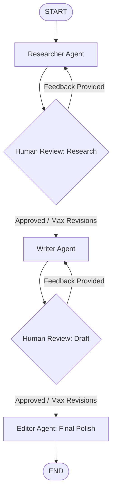

# Blogiee AI ✍️🤖

**Blogiee AI** is an intelligent, multi-agent blog generation system built with **LangGraph**, **LangChain**, and **Groq LLM**. It implements an interactive **Human-in-the-Loop (HITL)** workflow, enabling users to review and revise research outlines and blog drafts before generating the final, polished publication-ready post.

---

## 🚀 Architecture & Workflow

The pipeline consists of specialized agents coordinated via a stateful directed graph with pausing checkpoints (`interrupt()`):



### 1. Researcher Agent
- Analyzes the blog topic and target audience.
- Produces a concise 5–7 point research outline, statistics, and suggested hooks.
- Addresses prior human feedback if revisions are requested.

### 2. Human-in-the-Loop (Research Review)
- Pauses execution (`interrupt()`) to show the research outline to the human.
- The user can **approve** or provide **feedback** (up to 3 revision cycles).

### 3. Writer Agent
- Uses the approved research outline to write an engaging 500–800 word blog post tailored to the target audience.

### 4. Human-in-the-Loop (Draft Review)
- Pauses execution (`interrupt()`) for human review of the written draft.
- The user can approve or ask for edits.

### 5. Editor / Final Polish Agent
- Fixes grammar, awkward phrasing, and flow.
- Ensures humanized tone and applies formatting (bold headings and italicized subheadings).

---

## 📁 Project Structure

```text
BLOG_AI/
│
├── state.py            # Pydantic state schema (BlogState)
├── agent.py            # Prompts and LLM agent functions (Researcher, Writer, Editor)
├── graph.py            # LangGraph StateGraph, conditional edges, and checkpointing
├── app_main.py         # Interactive CLI application handling the HITL review loop
├── requirements.txt    # Project dependencies
├── .env                # API keys and environment variables
└── README.md           # Documentation
```

---

## 🛠️ Setup & Installation

### 1. Prerequisites
- Python 3.10+
- A [Groq Cloud](https://console.groq.com/) API Key

### 2. Clone or Navigate to the Project
```bash
cd "d:\GEN AI PROJECTS\BLOG_AI"
```

### 3. Create and Activate a Virtual Environment
```bash
# Windows (PowerShell)
python -m venv .venv
.\.venv\Scripts\Activate.ps1
```

### 4. Install Dependencies
```bash
pip install -r requirements.txt
```

### 5. Configure Environment Variables
Create a `.env` file in the root directory:
```env
GroqKEY=your_groq_api_key_here
```

---

## 💻 Running the Application

Start the interactive CLI:

```bash
python app_main.py
```

### Interactive Usage Example:
1. **Enter Topic:** `Agentic AI and LangGraph`
2. **Enter Audience:** `Software Engineers and AI enthusiasts`
3. **Research Review:**
   - Type `approve` to proceed, OR
   - Enter revision feedback (e.g., `"Include a section comparing LangGraph with standard chains."`)
4. **Draft Review:**
   - Review the generated 500–800 word draft.
   - Type `approve` to finalize or give feedback to refine the tone.
5. **View Final Output:** The editor agent outputs the polished final blog.
6. Type `exit` or `quit` anytime to terminate.

---

## ⚙️ Key Concepts

- **LangGraph Checkpointing (`InMemorySaver`)**: Preserves thread state across interrupt pauses so execution resumes exactly where it left off.
- **Human-in-the-Loop (`interrupt` & `Command(resume=...)`)**: Enables pause-and-resume interaction patterns directly inside agent workflows without manual state serialization.
- **Conditional Routing**: Automatically manages revision caps (`MAX_REVISION = 3`) to prevent infinite review loops.

